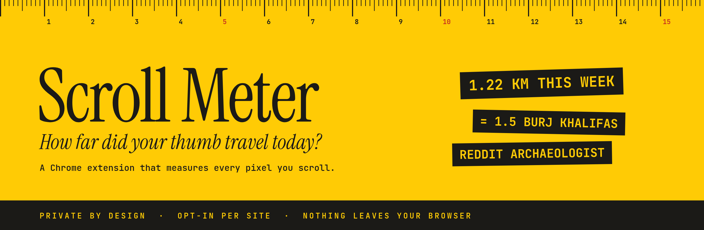
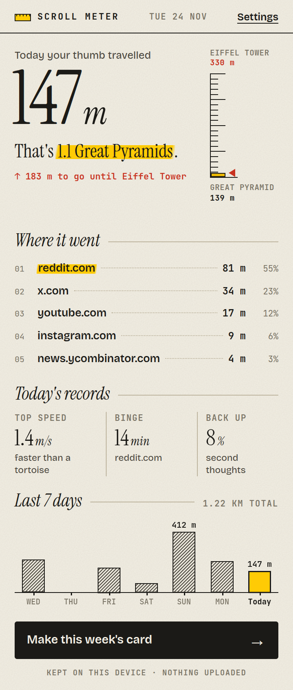
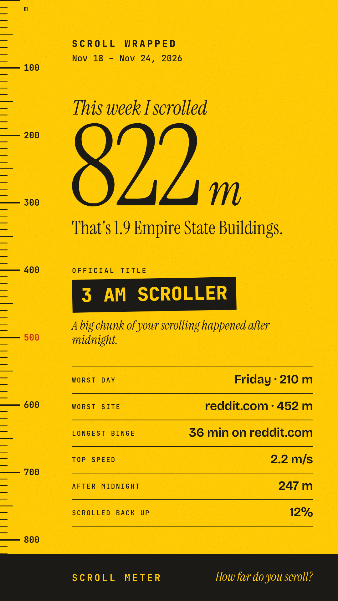
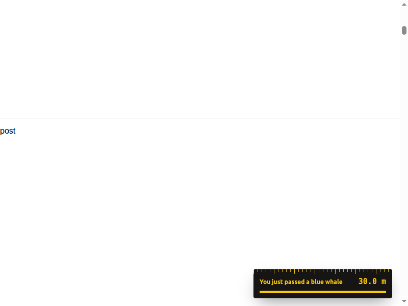
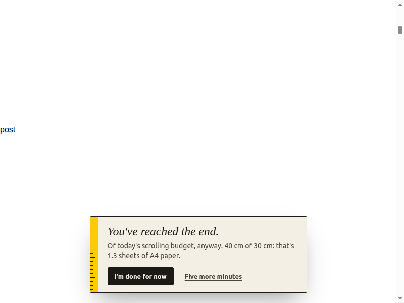

<p align="center">
  
</p>

<p align="center">
  <a href="manifest.json"></a>
  <a href="package.json"></a>
  <a href="PRIVACY.md"></a>
  <a href="LICENSE"></a>
</p>

<p align="center">
  <b>Scroll Meter</b> measures how far you physically scroll every day and turns it into<br />
  real-world comparisons you'll want to screenshot, and slightly regret.
</p>

<p align="center"><i>"Today you scrolled 147 m. That's 1.1 Great Pyramids. 183 m to go until the Eiffel Tower."</i></p>

---

<table>
  <tr>
    <td align="center" width="33%"></td>
    <td align="center" width="33%"></td>
    <td align="center" width="33%"></td>
  </tr>
  <tr>
    <td align="center"><sub><b>The popup.</b> Today's distance, the next landmark, where it went, records.</sub></td>
    <td align="center"><sub><b>Scroll Wrapped, Tape.</b> The ruler is scaled to your actual week.</sub></td>
    <td align="center"><sub><b>Scroll Wrapped, Receipt.</b> An itemized receipt of shame.</sub></td>
  </tr>
</table>

## Why

Screen-time apps tell you *how long*. Nobody tells you *how far*. A thumb that flicks through a feed
for an evening covers the height of a skyscraper, and a number like "412 m" lands differently than
"2 h 14 min". Scroll Meter makes that distance visible, makes it funny, and makes it shareable.

## Features

| Feature | What you get |
| --- | --- |
| **Daily distance** | Every pixel you scroll, up and down, converted to meters (or feet) and compared to something you can picture. |
| **The climb** | A ruler in the popup and a strip of tape on the page count down to the next landmark, and mark it when you pass one. |
| **Where it went** | Distance per site, a 7-day chart, and a toolbar badge with today's total. |
| **Daily records** | Top scrolling speed (*"faster than a walking human"*), longest binge on one site, and how much you scrolled back up. |
| **Scroll Wrapped** | A weekly card with your total, worst day, worst site, records and a roast title. Two styles, Story (9:16) and Square (1:1), exported as PNG or copied to the clipboard. |
| **Daily limit** | An optional nudge slides up when you pass your limit, then again every extra 50%. It never blocks anything. |
| **Opt-in sites** | Pick Reddit, X, YouTube, Instagram or any domain. Chrome asks once per site. Measuring every website is available, never assumed. |
| **Your data, your device** | Export everything as JSON or delete it in one click. Nothing is ever uploaded. |

### The comparison ladder

Comparisons scale with the number, so a quiet morning and a lost weekend both get a fitting answer.

| Landmark | Distance | | Landmark | Distance |
| --- | ---: | --- | --- | ---: |
| Double-decker bus | 11.2 m | | Empire State Building | 443 m |
| Blue whale | 30 m | | Burj Khalifa | 828 m |
| Olympic pool | 50 m | | Golden Gate Bridge | 2.74 km |
| Football pitch | 105 m | | Mount Everest | 8.85 km |
| Great Pyramid | 139 m | | Marathon | 42.2 km |
| Eiffel Tower | 330 m | | Trip to the Space Station | 408 km |

### Roast titles

Your weekly card earns a title based on how, when and where you scrolled: *Touch Grass Champion*,
*3 AM Scroller*, *Professional Doomscroller*, *Reddit Archaeologist*, *LinkedIn Lurker*, *Timeline
Tourist*, *Comment Section Spelunker*, *Tab Tornado*, *Thumb Marathoner* and more.

<table>
  <tr>
    <td width="50%"></td>
    <td width="50%"></td>
  </tr>
  <tr>
    <td align="center"><sub>Passing a landmark while you scroll.</sub></td>
    <td align="center"><sub>The daily limit nudge.</sub></td>
  </tr>
</table>

## How it measures

Distance uses the CSS definition of a pixel, so the number is consistent on any screen:

```
1 CSS px = 1/96 inch = 0.026458 cm        →        1 km ≈ 3.78 million px
```

A content script listens for `scroll` events in the capture phase, which catches the window **and**
inner scroll containers (most modern feeds), and adds up the absolute change in position. To keep
the numbers honest:

- **Only you count.** Scrolling is counted only within 3 seconds of real input: wheel, touch,
  keyboard or dragging the scrollbar. Live chats, tickers and pages that scroll themselves add nothing.
- **Jumps are ignored.** A single movement over 5,000 px (anchor links, scroll restoration) and
  sub-pixel jitter are dropped.
- **Writes are batched.** Totals are sent every 3 seconds and when the tab is hidden, then written by
  the service worker one at a time so tabs never overwrite each other.

Pages that animate content with CSS transforms or virtual scrolling instead of real scrolling may
undercount. That is a deliberate trade-off: Scroll Meter never reads page content to guess.

## Privacy

Scroll Meter is built so there is nothing to leak.

- **It runs only where you allow it.** There is no install-time *"read and change all your data"*
  warning. Each site is requested individually when you switch it on.
- **It stores numbers, not browsing.** A domain name, pixel counts per day and hour, and daily
  records. No URLs, no titles, no page content.
- **Nothing leaves your browser.** No servers, no analytics, no accounts, no network requests of any kind.

| Permission | Used for |
| --- | --- |
| `storage` | Keeping your totals and settings on your device |
| `scripting` | Starting the measurement script on the sites you pick |
| `activeTab` | Letting the popup tell you whether the current site is measured |
| `alarms` | Resetting the toolbar badge at midnight |
| Optional site access | Requested per site, only when you turn that site on |

Read the full [privacy policy](PRIVACY.md).

## Install

Scroll Meter is heading to the Chrome Web Store. Until then, load it from source in under a minute:

```bash
git clone https://github.com/beastb728/scroll-meter.git
```

1. Open `chrome://extensions` and switch on **Developer mode**.
2. Click **Load unpacked** and choose the `scroll-meter` folder.
3. Pick the sites you want measured on the welcome page, then go scroll something.

Works in Chrome and Chromium-based browsers (Edge, Brave, Arc, Opera) that support Manifest V3.

## Development

No build step and no dependencies. The source you read is the extension that runs.

```bash
npm test          # unit tests with node:test
npm run icons     # regenerate icons/ from scripts/make-icons.mjs
npm run package   # build dist/scroll-meter-<version>.zip for the Chrome Web Store
```

Open `src/wrapped/wrapped.html?demo=1` inside the extension to render the weekly card with sample data.

### Architecture

```
┌────────────────────────────┐                                ┌────────────────────────────┐
│ content.js                 │   scroll batches, every 3 s    │ background.js              │
│ runs on sites you pick     │  ────────────────────────────► │ service worker             │
│ measures, overlay, nudge   │  ◄──────────────────────────── │ writes, records, badge     │
└────────────────────────────┘   total, landmarks, nudges     └────────────────────────────┘
                                                                            │ saves
                                                                            ▼
┌────────────────────────────┐                                ┌────────────────────────────┐
│ popup · settings ·         │             reads              │ chrome.storage.local       │
│ weekly card                │  ◄──────────────────────────── │ on your device only        │
└────────────────────────────┘                                └────────────────────────────┘
```

### Project layout

```
manifest.json
src/
  content.js         measurement, live overlay, limit nudge (shadow DOM)
  background.js      permissions → content scripts, storage writes, records, badge
  popup/             toolbar popup
  settings/          site picker, daily limit, units, export and delete
  wrapped/           weekly card page and canvas renderer
  lib/               storage, units and comparisons, stats, site permissions
  ui/                design tokens, bundled fonts, the 7-day chart
tests/               unit tests for the pure modules in src/lib
scripts/             icon generator, banner source, packaging
```

### Storage

Everything lives in `chrome.storage.local`, one key per day:

| Key | Value |
| --- | --- |
| `YYYY-MM-DD` | `{ "reddit.com": px, "x.com": px, … }` |
| `hours:YYYY-MM-DD` | 24 numbers, pixels per local hour |
| `meta:YYYY-MM-DD` | `{ upPx, peakPxS, binge: { site, ms, px } }` |
| `settings` | units, daily limit, overlay and badge toggles |

## FAQ

**Why is my number different from a friend's on the same feed?**
Distance is measured in CSS pixels, which depend on zoom level and the layout each site serves.
Your numbers are consistent with each other, which is what matters for your week.

**Does it work on my phone?**
Not yet. Chrome on Android and iOS doesn't run extensions. A Firefox port is planned, and Firefox
for Android supports extensions.

**Why does it ask permission for each site?**
So you never have to trust it with everything. You choose exactly where it runs, and you can take
that back at any time from Settings or Chrome itself.

## Roadmap

- [x] Scroll measurement with honest filtering
- [x] Popup with comparisons, climb, top sites and 7-day chart
- [x] Scroll Wrapped weekly card in two styles and two sizes
- [x] Opt-in sites, daily limit nudge, settings
- [x] Live climb overlay, milestones, toolbar badge
- [x] Daily records: top speed, longest binge, scroll-back
- [ ] Chrome Web Store release
- [ ] Firefox port
- [ ] Friend leagues with share codes, no server required
- [ ] Monthly and yearly Wrapped

## Contributing

Issues and pull requests are welcome. Keep the privacy model intact: no network requests, no page
content, domains and numbers only. Run `npm test` before opening a PR, and include a screenshot for
anything visual.

## License

[MIT](LICENSE) © beastb728

Bundled typefaces, all under the [SIL Open Font License](src/ui/fonts/):
[Instrument Serif](https://github.com/Instrument/instrument-serif),
[Bricolage Grotesque](https://github.com/ateliertriay/bricolage) and
[JetBrains Mono](https://github.com/JetBrains/JetBrainsMono).
