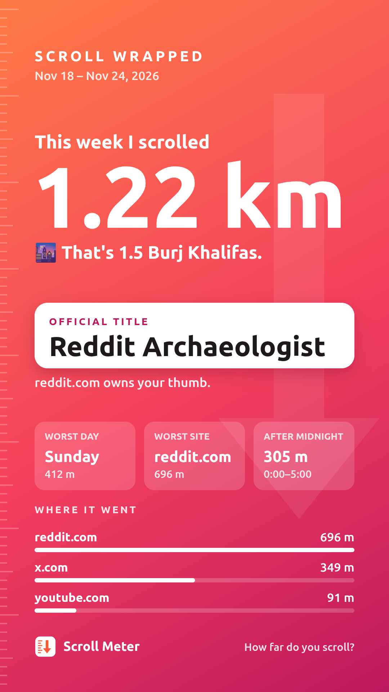
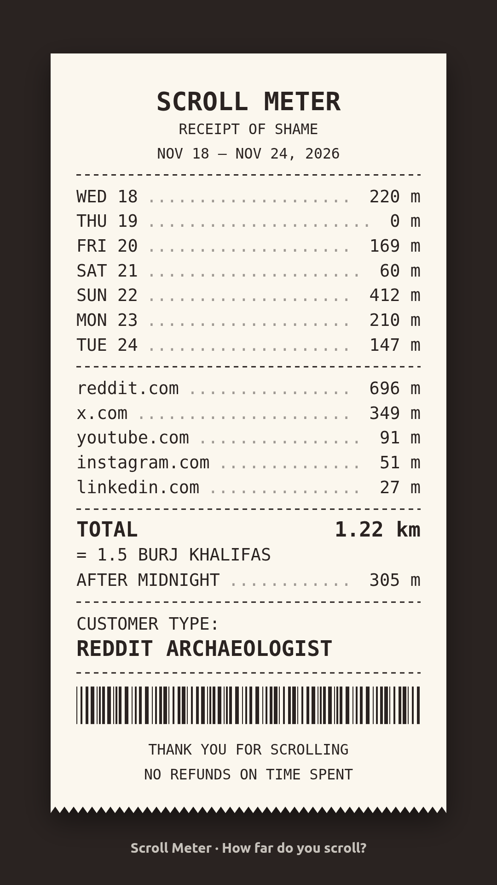

# Scroll Meter

A Chrome extension that measures how far you physically scroll every day and turns it
into ridiculous real-world comparisons. *"Today you scrolled 142 m. That's 4.7 blue whales nose to tail."*

Fun, a little guilt-inducing, and made to be screenshotted.

<p>
  
  
  
</p>

## Features

- **Daily total** with a comparison that fits the number (blue whales → Eiffel Towers → Everest)
- **Top sites** and a **7-day chart** in the toolbar popup
- **Scroll Wrapped**: a weekly shareable card with your total, worst day, worst site,
  after-midnight scrolling and a roast title ("Reddit Archaeologist", "3 AM Scroller",
  "Professional Doomscroller"). Two styles (Poster, Receipt), two sizes (Story 9:16 for
  Instagram/WhatsApp Status, Square 1:1 for feeds). Download as PNG or copy to clipboard.

## How it measures

- Every vertical scroll movement (up **and** down) on the page and inside inner scroll
  containers (feeds that don't scroll the window) is added up as absolute distance.
- Pixels become real distance using the CSS definition: 1 px = 1/96 inch ≈ 0.0265 cm.
  Your physical screen size varies, but the number stays consistent.
- Single jumps over 5,000 px (anchor links, "scroll restoration") and sub-pixel jitter are ignored.
- Pages that use transform-based or virtual scrolling may undercount.

## Privacy

- Stores **domain names and distances only**. No URLs, no page content, no history.
- Everything stays in `chrome.storage.local` on your device. Nothing is ever sent anywhere.
- No analytics, no accounts, no network requests.

## Install (development)

1. `chrome://extensions` → enable **Developer mode**
2. **Load unpacked** → select this folder

## Project layout

```
manifest.json
src/background.js     service worker: receives batched scroll totals, writes storage
src/content.js        measures scrolling on the page
src/popup/            toolbar popup: today, comparison, top sites, 7-day chart
src/wrapped/          weekly Scroll Wrapped card (canvas → PNG); add ?demo=1 for sample data
src/lib/              shared helpers (storage, units + comparison ladder, stats)
src/ui/               shared styles and the canvas bar chart
tests/                unit tests: npm test
icons/                generated by scripts/make-icons.mjs
```

## Roadmap

- [x] **M1** Scroll tracking + storage
- [x] **M2** Popup: today's distance, comparison, top sites, 7-day chart
- [x] **M3** Weekly "Scroll Wrapped" shareable card (PNG)
- [ ] **M4** Opt-in per-site tracking, daily limit nudge, settings
- [ ] **M5** Live climb overlay, milestones, toolbar badge

## License

MIT
